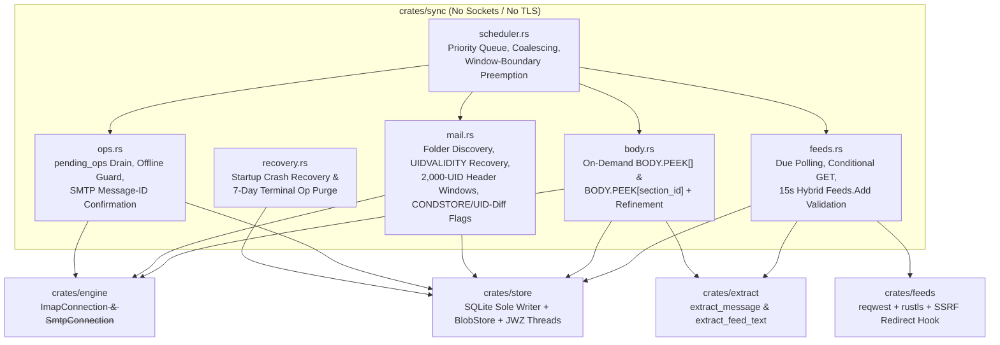

# Phase 2D Implementation Plan: Sync Orchestration (`crates/sync`)

## Goal Description

Implement Phase 2D of `debloatmail`: the sync orchestration layer in [`crates/sync`](file:///home/nvalk1/debloatmail/crates/sync) (along with supporting storage helpers in [`crates/store`](file:///home/nvalk1/debloatmail/crates/store) and feed fetch/parse refinements in [`crates/feeds`](file:///home/nvalk1/debloatmail/crates/feeds)), connecting [`crates/core`](file:///home/nvalk1/debloatmail/crates/core), [`crates/store`](file:///home/nvalk1/debloatmail/crates/store), [`crates/extract`](file:///home/nvalk1/debloatmail/crates/extract), [`crates/feeds`](file:///home/nvalk1/debloatmail/crates/feeds), [`crates/auth`](file:///home/nvalk1/debloatmail/crates/auth), and [`crates/engine`](file:///home/nvalk1/debloatmail/crates/engine).

Per [`docs/SYNC.md`](file:///home/nvalk1/debloatmail/docs/SYNC.md) §2 and [`GEMINI.md`](file:///home/nvalk1/debloatmail/GEMINI.md), **`crates/sync` contains no sockets and no TLS**: all IMAP and SMTP operations run over [`ImapConnection<S: AsyncByteStream>`](file:///home/nvalk1/debloatmail/crates/engine/src/imap/session.rs#L298-L303) and [`SmtpConnection<S: AsyncByteStream>`](file:///home/nvalk1/debloatmail/crates/engine/src/smtp/mod.rs#L52-L57) so that every sync, crash-recovery, `UIDVALIDITY`, and `pending_ops` scenario in [`docs/SYNC.md`](file:///home/nvalk1/debloatmail/docs/SYNC.md) §15 is deterministically testable against in-memory streams ([`MemoryStream`](file:///home/nvalk1/debloatmail/crates/engine/src/io.rs#L179-L185)) with zero network access.

Once you approve this plan, I will copy it verbatim to `docs/PHASE-2D-PLAN.md` and commit it so you can start a fresh session with full context.

---

## User Review Required

> [!IMPORTANT]
> **Dependency Additions (Per `GEMINI.md` "Ask First" Rule)**
> 1. **Root [`Cargo.toml`](file:///home/nvalk1/debloatmail/Cargo.toml)**:
>    - Add `"crates/sync"` to `[workspace].members` and `debloatmail-sync = { path = "crates/sync" }` to `[workspace.dependencies]`.
>    - Add `blake3 = "1.8.7"`, `serde = { version = "1.0.229", features = ["derive"] }`, and `serde_json = "1.0"` to `[workspace.dependencies]` (all three are already present in the local Cargo cache / `Cargo.lock` and pass `cargo deny --offline check all`).
> 2. **[`crates/store/Cargo.toml`](file:///home/nvalk1/debloatmail/crates/store/Cargo.toml)**:
>    - Add `blake3 = { workspace = true }` for content-addressed `blobs.hash` (`DATA-MODEL.md` §5: `hash TEXT PRIMARY KEY -- BLAKE3 of raw bytes`) and `serde` / `serde_json` for structured address/attachment JSON columns.
> 3. **[`crates/sync/Cargo.toml`](file:///home/nvalk1/debloatmail/crates/sync/Cargo.toml)**:
>    - Workspace crates: `debloatmail-core`, `debloatmail-store`, `debloatmail-extract`, `debloatmail-feeds`, `debloatmail-auth`, `debloatmail-engine`.
>    - External workspace dependencies: `rusqlite`, `thiserror`, `io-imap`, `io-smtp`, `tokio`, `serde`, `serde_json`, `blake3`.
> 4. **Zero Schema/Migration Changes**:
>    - [`crates/store/src/migrations/0001_init.sql`](file:///home/nvalk1/debloatmail/crates/store/src/migrations/0001_init.sql) already matches `DATA-MODEL.md` v3 §5 verbatim. No SQL DDL changes are needed.

> [!NOTE]
> **Standing Commit Rule**
> Every newly created file in Phase 2D will be committed individually with its own focused git commit.

---

## Architecture & Data Flow



---

## Proposed Changes

### Component 1: Supporting Storage Helpers (`crates/store`)

No changes to [`0001_init.sql`](file:///home/nvalk1/debloatmail/crates/store/src/migrations/0001_init.sql). We add the missing Rust storage modules required by `SYNC.md` and `DATA-MODEL.md` §5, §8, §9, and §11.

#### [MODIFY] [Cargo.toml](file:///home/nvalk1/debloatmail/crates/store/Cargo.toml)
- Add `blake3 = { workspace = true }`, `serde = { workspace = true }`, and `serde_json = { workspace = true }`.

#### [NEW] `crates/store/src/blobs.rs`
Implements content-addressed on-disk blob management and LRU cache eviction (`DATA-MODEL.md` §5, §9.1–9.3; `SECURITY.md` §8.1–8.4):
- `blob_path(cache_dir: &Path, hash: &str) -> Result<PathBuf, StoreError>`: validates 64-char hex BLAKE3 hash and resolves `$XDG_CACHE_HOME/debloatmail/blobs/<hash[0:2]>/<hash>` (traversal-safe by construction).
- `put_blob(conn: &Connection, cache_dir: &Path, data: &[u8], now: Timestamp) -> Result<String, StoreError>`:
  - Computes `blake3::hash(data).to_hex()`.
  - Creates parent directories with mode `0o700` and writes the blob file with `0o600` (`O_CREAT | O_EXCL | O_NOFOLLOW` via `secure_file::secure_create`).
  - Upserts the `blobs` row (`hash`, `size_bytes`, `refcount`, `last_used_at = now`, `created_at = now`).
- `increment_blob_ref(conn: &Connection, hash: &str, now: Timestamp) -> Result<(), StoreError>` and `decrement_blob_ref(conn: &Connection, hash: &str) -> Result<(), StoreError>`:
  - Maintains `blobs.refcount` inside the same transaction as `mail_items.raw_blob` or `attachments.blob_hash` updates (`DATA-MODEL.md` §5).
- `touch_blob(conn: &Connection, cache_dir: &Path, hash: &str, now: Timestamp) -> Result<PathBuf, StoreError>`:
  - Updates `blobs.last_used_at = now` for the 1-hour grace window (`DATA-MODEL.md` §9.3) and returns the on-disk path.
- `gc_blobs(conn: &Connection, cache_dir: &Path, now: Timestamp) -> Result<usize, StoreError>`:
  - Collects rows in `blobs` where `refcount <= 0 AND last_used_at < now - 3600`, unlinks their files from `cache_dir`, and deletes the `blobs` rows (`DATA-MODEL.md` §9.3).
- `reconcile_blob_refcounts(conn: &Connection) -> Result<Vec<BlobRefcountDiscrepancy>, StoreError>`:
  - Recomputes actual non-NULL references across `mail_items.raw_blob` and `attachments.blob_hash` and compares against `blobs.refcount` for `debloatmailctl doctor` (`DATA-MODEL.md` §5, §16).
- `evict_lru_mail_bodies(conn: &Connection, max_total_bytes: u64) -> Result<usize, StoreError>`:
  - Evicts oldest mail bodies (`durable = 0`, `starred = 0`, and no active `pending_ops` row) by setting `item_text.body = ''`, `items.body_state = 'none'`, `items.excerpt = NULL`, and clearing `mail_items.raw_blob` (decrementing `blobs.refcount`) while retaining `item_text.(title, author)` so subject/author search continues to work (`DATA-MODEL.md` §9.2).
- `evict_lru_attachment_blobs(conn: &Connection, max_total_bytes: u64) -> Result<usize, StoreError>`:
  - Clears `attachments.blob_hash = NULL` (decrementing `blobs.refcount`) on oldest unstarred items without active `pending_ops` (`DATA-MODEL.md` §9.3).

#### [NEW] `crates/store/src/threads.rs`
Implements per-account local conversation threading (`DATA-MODEL.md` §4.4, §8; `SYNC.md` §3.1):
- `rebuild_account_threads(conn: &Connection, account_id: i64, mut mint_public_id: impl FnMut() -> String) -> Result<usize, StoreError>`:
  - Groups mail items in `account_id` using `message_id`, `in_reply_to`, `references_hdr` (JWZ reference graph root resolution), falling back to non-empty `subject_norm` within the same account when references are absent (`DATA-MODEL.md` §8).
  - Preserves existing `threads.public_id` when matching `(account_id, root_msgid)` or existing thread assignment.
  - Updates `items.thread_id` for all mail items in the account (`feed` items always keep `thread_id = NULL`).
  - Recomputes `threads.(last_activity, item_count, unread_count)` strictly over **`visible_items` (`hidden_at IS NULL`)** (`DATA-MODEL.md` §4.4, §8) and removes empty threads.

#### [MODIFY] [headers.rs](file:///home/nvalk1/debloatmail/crates/store/src/headers.rs) and [lib.rs](file:///home/nvalk1/debloatmail/crates/store/src/lib.rs)
- Add `upsert_mail_header` (idempotent on `(folder_id, uidvalidity, uid)` per `SYNC.md` §11.4, updating flags if no pending `flag` op exists for the item, or inserting `items` + `mail_items` + `item_text(title, author, body = '')`).
- Add `replace_provisional_attachments` (for header-time `BODYSTRUCTURE` seeding when `body_state != 'cached'`) and `reconcile_extracted_attachments` (authoritative body-walk refinement rule per `SYNC.md` §6.1: removes provisional parts absent from the walk, adds new parts, updates existing parts with authoritative `size_bytes`, `mime_type`, `filename`, `content_id`, `is_pdf`, and updates `items.has_attachments`).
- Re-export `blobs` and `threads` in [`crates/store/src/lib.rs`](file:///home/nvalk1/debloatmail/crates/store/src/lib.rs).

---

### Component 2: Feed Redirect Hook & Metadata Refinements (`crates/feeds`)

Refines [`crates/feeds`](file:///home/nvalk1/debloatmail/crates/feeds) to satisfy all requirements of `SYNC.md` §7.1–7.4 and `SECURITY.md` §5.4.

#### [MODIFY] [fetch.rs](file:///home/nvalk1/debloatmail/crates/feeds/src/fetch.rs)
- Implement `validate_redirect_target(initial_url: &reqwest::Url, target_url: &reqwest::Url, hop_count: usize) -> Result<(), RedirectViolation>` inside the `reqwest::redirect::Policy::custom` closure (`SECURITY.md` §5.4, `SYNC.md` §2, §7.1):
  - Reject `hop_count > 5` (`FetchError::TooManyRedirects`).
  - Reject non-`http`/`https` schemes and `https -> http` scheme downgrades (`FetchError::RedirectRejected`).
  - Reject redirects to loopback (`127.0.0.0/8`, `::1`, `localhost`), link-local (`169.254.0.0/16`, `fe80::/10`), or RFC 1918 private addresses unless `initial_url` was already targeting that scope (`FetchError::RedirectRejected`).
- Track whether a redirect chain was permanent (`301` / `308` -> `permanent_redirect_url: Option<String>`) vs temporary (`302` / `307`) so `crates/sync` updates `feeds.url` in-place **only** on `301`/`308` (`SYNC.md` §7.1).
- Parse `Retry-After` (seconds) on `429` and `503` responses into `FetchError::RateLimited { status, retry_after_secs }` and surface `404`/`410` as `FetchError::Gone(u16)` (`SYNC.md` §7.1).
- Allow caller-specified request timeout (`fetch_feed_with_timeout`) so `Feeds.Add` can pass the 15-second validation budget (`SYNC.md` §7.4).

#### [MODIFY] [parse.rs](file:///home/nvalk1/debloatmail/crates/feeds/src/parse.rs) and [poll.rs](file:///home/nvalk1/debloatmail/crates/feeds/src/poll.rs)
- Add `ParsedFeed { pub title: Option<String>, pub site_url: Option<String>, pub entries: Vec<ParsedEntry> }` and `parse_feed_document(bytes: &[u8]) -> Result<ParsedFeed, ParseError>` while keeping `parse_feed(bytes)` for backwards compatibility with existing `crates/feeds` tests.
- Distinguish `entry.content` vs `entry.summary` on `ParsedEntry` so `debloatmail_extract::extract_feed_text` can resolve relative links against `site_url` (`MIME-AND-TEXT.md` §11).
- Fix `poll_feed` in [`crates/feeds/src/poll.rs`](file:///home/nvalk1/debloatmail/crates/feeds/src/poll.rs) so it upserts entries in-place without deleting existing `feed_items`/`items` rows first (preserving `unread`, `starred`, and `hidden_at` per `SYNC.md` §7.2).

---

### Component 3: Sync Orchestration Crate (`crates/sync`)

#### [MODIFY] [Cargo.toml](file:///home/nvalk1/debloatmail/Cargo.toml) and [NEW] [crates/sync/Cargo.toml](file:///home/nvalk1/debloatmail/crates/sync/Cargo.toml)
- Register `crates/sync` (`debloatmail-sync`) in the workspace.

#### [NEW] `crates/sync/src/id.rs`
- Pure-Rust RFC 9562 UUIDv7 generator:
  - `mint_uuid_v7(unix_ms: u64, rng: &mut dyn Rng) -> PublicId`
  - `mint_uuid_v7_from_clock(clock: &dyn Clock, rng: &mut dyn Rng) -> PublicId`
  - Produces canonical lowercase 8-4-4-4-12 UUIDv7 strings (`018f...`), time-ordered by millisecond epoch with RFC 9562 version `7` and variant `0b10` bits set.

#### [NEW] `crates/sync/src/scheduler.rs`
Implements the priority queue, job model, coalescing, interval clamping, and signal/progress throttling (`SYNC.md` §3, §4, §13):
- `PriorityClass`: `Interactive` > `Maintenance` > `Housekeeping` (`SYNC.md` §3.1).
- `JobId(pub u32)`, `JobState` (`Queued`, `Running`, `Done`, `Failed`, `Cancelled`).
- `JobScope`:
  - `AccountSync { account_id: Option<AccountId>, folder_id: Option<FolderId>, full: bool }`
  - `FeedRefresh { feed_id: Option<FeedId> }`
  - `BodyFetch { item_id: PublicId }`
  - `AttachmentFetch { item_id: PublicId, section_id: String }`
  - `QueueDrain { account_id: AccountId }`
  - `HousekeepingGc`, `ThreadRebuild { account_id: AccountId }`, `Reextract`
- **Coalescing (`SYNC.md` §4.3)**:
  - `Scheduler::enqueue(scope, priority, now_ms)`: if a job with the same `JobScope` is currently `Queued` or `Running`, or finished `Done` within the last `1_000 ms`, returns the existing `JobId` without queueing a duplicate.
- **Cooperative Cancellation & Window-Boundary Preemption (`SYNC.md` §3.1, §3.2, §4.4)**:
  - `CancelToken` (atomic boolean checked between protocol commands, never mid-command).
  - `Scheduler::has_interactive_waiter(account_id)`: checked by `AccountSync` at every committed 2,000-UID window boundary so an interactive `BodyFetch` or `AttachmentFetch` on the same (or any) account preempts immediately between windows (`SYNC.md` §3.1 rules 1 & 2).
- **Scheduling Intervals (`SYNC.md` §3.4)**:
  - `effective_feed_interval_secs(feed_interval: Option<i64>, account_interval: Option<i64>, config_default: u64) -> (u64, bool)`: treats `Some(0)` as `None`, defaults to `3600` s, clamps values `< 300` s to `300` s and returns `clamped = true` so callers can log a warning.
  - `effective_mail_interval_secs(account_interval: Option<i64>, config_default: u64) -> (u64, bool)`: treats `Some(0)` as `None`, defaults to `900` s, clamps values `< 60` s to `60` s.
  - Applies deterministic per-account ±10% jitter via `debloatmail_engine::deterministic_account_jitter`.
- **Progress & Signal Throttling (`SYNC.md` §13)**:
  - `SyncPhase` (`Connecting`, `Listing`, `Fetching`, `Parsing`, `Storing`, `Done`), `INDETERMINATE_PERCENT: u32 = 0xFFFF_FFFF`.
  - `ProgressTracker`: emits `SyncEvent::SyncProgress` immediately on phase transitions and throttles intra-phase updates to at most 4 Hz (every 250 ms), while always emitting `100%` at phase completion (`SYNC.md` §13.3).

#### [NEW] `crates/sync/src/recovery.rs`
Implements startup crash recovery and housekeeping retention (`SYNC.md` §8.6, §11.1):
- `run_startup_recovery(conn: &Connection, now: Timestamp) -> Result<StartupRecoveryReport, SyncError>`:
  1. Resets `items.body_state = 'pending'` to `'none'` (`SYNC.md` §6.1, §11.1).
  2. Leaves `pending_ops.state = 'in_flight'` in `'in_flight'`; marks any `in_flight` `send` ops in their JSON payload with `"needs_confirmation": true` so their first retry executes the §8.4 `Message-ID` search rather than a blind resend (`SYNC.md` §11.1).
  3. Clamps any `folders.last_sync_at > now` back to `now` (`SYNC.md` §11.1).
  4. Purges terminal `pending_ops` (`state IN ('done', 'failed')` where `finished_at <= now - 7 * 86_400`, `SYNC.md` §8.6).

#### [NEW] `crates/sync/src/mail.rs`
Implements IMAP folder discovery, `UIDVALIDITY` staged recovery, windowed header sync, `CONDSTORE`/UID-diff flag sync, and IDLE watch orchestration (`SYNC.md` §5.1–5.8, §11.3–11.4):
- **Folder Discovery Reconciliation (`reconcile_account_folders`)**:
  - Runs `ImapMailboxList` and `debloatmail_engine::imap::discover_folders`.
  - Upserts `folders` rows: preserves user-assigned `role_source = 'manual'`; enforces role uniqueness per account; marks folders absent from `LIST` as `subscribed = 0` without deleting them (`SYNC.md` §5.3); skips `\Noselect` and `\All` (`sync_by_default == false`) during default account sync (`SYNC.md` §5.8).
- **`UIDVALIDITY` Staged Recovery (`run_uidvalidity_staged_recovery`)** (`SYNC.md` §5.4):
  - Triggered when `server_uidvalidity != stored_uidvalidity` (and `stored_uidvalidity != 0`), or `server_uidnext < stored_uidnext` (`UIDNEXT` went backwards), or `full_sync == true` (`sync --full`).
  - Follows the 7-step procedure of `SYNC.md` §5.4:
    1. Detect reset / full-sync request.
    2. Build `HashMap<String, String>` (`message_id -> public_id`) from the folder's current rows.
    3. Snapshot queued `pending_ops` (`state IN ('pending', 'in_flight')`) referencing items in this folder (`op_id -> message_id`).
    4. Delete all `items` in the folder in one transaction (`pending_ops.item_id` becomes `NULL` via `ON DELETE SET NULL`; referenced blob refcounts are decremented).
    5. Refetch all headers in 2,000-UID windows via `fetch_header_window`, committing each window in its own transaction. Preserve `public_id` when `Message-ID` matches the map; mint a fresh UUIDv7 `public_id` otherwise and track `unpreserved_count` (recorded in `meta` under `uidvalidity_unpreserved:<folder_public_id>` so `doctor` can report it per `SYNC.md` §5.4).
    6. Rebind snapshotted `pending_ops` (`UPDATE pending_ops SET item_id = <new_rowid>`) for reappearing `Message-ID`s; leave missing items with `item_id = NULL` so the op drain fails/completes them explicitly with an explanatory `last_error` (`SYNC.md` §5.4 step 6).
    7. Advance `folders.(uidvalidity, uidnext, highestmodseq, last_sync_at)` in the final window commit.
- **Windowed Header Sync (`sync_folder_headers_windowed`)** (`SYNC.md` §5.5, §11.3):
  - Loops in 2,000-UID windows from `start_uid` (`1` on initial sync, `folders.uidnext` on incremental sync) up to `server_uidnext - 1`.
  - Parses `ENVELOPE`, `FLAGS`, `INTERNALDATE`, `RFC822.SIZE`, and `BODYSTRUCTURE`:
    - Decodes RFC 2047 encoded words in `Subject`, display names, and attachment filenames using `crates/extract` helpers.
    - Derives `title`, `author`, `from_addr`, `to_addrs`, `cc_addrs`, `reply_to`, `message_id`, `in_reply_to`, `subject_norm`, `published_at`, `sort_at` (from `INTERNALDATE`, fallback `now`), `unread` (`!\Seen`), `starred` (`\Flagged`), `answered` (`\Answered`), and `flags_local` (custom keywords only, excluding `\Seen`, `\Flagged`, `\Answered`, `\Deleted`, `\Draft`, `\Recent` per `DATA-MODEL.md` §7).
    - Walks `BODYSTRUCTURE` to assign RFC 3501 §6.4.5 `section_id`s (`"1"`, `"2"`, `"1.2"`, etc.) and seed provisional `attachments` rows + `items.has_attachments`.
  - Commits each 2,000-UID window and advances `folders.uidnext` in the **same** transaction (`SYNC.md` §11.3).
  - Between windows, checks `CancelToken` and yields if an `Interactive` job is waiting (`SYNC.md` §3.1, §4.4).
- **Flag & Expunge Sync (`sync_folder_flags_and_expunges`)** (`SYNC.md` §5.6):
  - **CONDSTORE path**: when `conn.capabilities.condstore` and `folder.highestmodseq > 0`, issues `UID FETCH 1:* (UID FLAGS) (CHANGEDSINCE <highestmodseq>)` and advances `folders.highestmodseq`.
  - **Fallback path**: fetches `UID FETCH <low_uid>:* (UID FLAGS)` over the tracked window (most recent 5,000 UIDs).
  - **Pending-op-wins rule (`SYNC.md` §5.6)**: ignores server flag changes for any item with an active (`pending` or `in_flight`) `flag` op in `pending_ops`.
  - **Expunge diff**: when `VANISHED` was not provided by `QRESYNC`, runs `UID SEARCH ALL` and deletes local `items` rows in the folder whose UIDs are no longer present on the server.

#### [NEW] `crates/sync/src/body.rs`
Implements on-demand `BodyFetch` and `AttachmentFetch` (`SYNC.md` §6.1, §6.2):
- `fetch_item_body<S: AsyncByteStream>(db, imap_conn, cache_dir, item_public_id, clock)`:
  - Sets `items.body_state = 'pending'`.
  - Selects the item's folder and calls `fetch_body_peek` (`UID FETCH <uid> (BODY.PEEK[])`).
  - Writes raw MIME bytes to `BlobStore`, links `mail_items.raw_blob`, and increments `blobs.refcount`.
  - Runs `debloatmail_extract::extract_message(&raw_bytes)`:
    - Updates `item_text.(body, extractor_version = CURRENT_EXTRACTOR_VERSION)` and `items.(excerpt, body_state = 'cached')`.
    - Updates `mail_items.(in_reply_to, references_hdr)` from extracted full headers if present.
    - Runs `reconcile_extracted_attachments` to apply the §6.1 authoritative attachment refinement rule.
  - On any network or extraction failure, sets `items.body_state = 'failed'` and returns the error.
- `fetch_item_attachment<S: AsyncByteStream>(db, imap_conn, cache_dir, item_public_id, section_id, clock) -> Result<PathBuf, SyncError>`:
  - Validates `section_id` with `validate_section_id` and verifies `(item_id, section_id)` exists in `attachments` (`SECURITY.md` §8.2).
  - If `attachments.blob_hash` is already cached on disk, touches `blobs.last_used_at = now` and returns the path (`DATA-MODEL.md` §9.3).
  - Otherwise selects the folder, calls `fetch_attachment_section` (`UID FETCH <uid> (BODY.PEEK[<section_id>])`), decodes transfer encoding if needed, stores the bytes in `BlobStore`, sets `attachments.blob_hash` + increments `blobs.refcount`, touches `last_used_at = now`, and returns the blob path.

#### [NEW] `crates/sync/src/ops.rs`
Implements the per-account `pending_ops` drain and SMTP send confirmation (`SYNC.md` §8.1–8.6, `DATA-MODEL.md` §11.5–11.7):
- Structured JSON payloads (`FlagOpPayload`, `MoveOpPayload`, `DeleteOpPayload`, `ExpungeOpPayload`, `SendOpPayload`) plus `queue_send_from_draft` (`DATA-MODEL.md` §11.5: reads local `drafts` row, embeds inline in `SendOpPayload` with a stable generated `Message-ID`, inserts `pending_ops` row, and deletes the `drafts` row in one transaction).
- `drain_account_ops<I, M>(db, imap_conn, smtp_sender, account_id, clock, rng)`:
  - Selects undrained ops (`state IN ('pending', 'in_flight')`) for `account_id` ordered by `created_at ASC, id ASC`.
  - Persists `state = 'in_flight'` **before** executing any network command (`SYNC.md` §8.2, §11.3).
  - Handles orphaned ops (`item_id IS NULL`):
    - `flag` / `move` / `delete` / `expunge` -> `state = 'failed'`, `finished_at = now`, `last_error = "target item no longer exists"`.
    - `send` -> still executes the self-sufficient SMTP send + Sent append from `SendOpPayload`; if an original replied-to item reference was lost, records that note in `last_error` while completing `state = 'done'` (`DATA-MODEL.md` §11.6).
  - Executes each op:
    - `Flag`: `UID STORE <uid> ±FLAGS.SILENT (\Seen, \Flagged, \Answered)`.
    - `Move`: `UID MOVE` when `capabilities.move_ext` is true; otherwise `UID COPY` + `UID STORE +FLAGS.SILENT (\Deleted)` + (`UID EXPUNGE` if `capabilities.uidplus`). Tolerates missing source UID on retry as already-completed (`SYNC.md` §8.3).
    - `Delete`: `UID STORE <uid> +FLAGS.SILENT (\Deleted)`, plus `UID EXPUNGE <uid>` if `capabilities.uidplus` (never plain `EXPUNGE`, `SYNC.md` §8.3).
    - `Expunge`: `uid_expunge_messages` (requires `UIDPLUS`; never issues plain `EXPUNGE`).
    - `Send`:
      1. **Confirmation path (`SYNC.md` §8.4)**: if `payload.needs_confirmation` is true (from a prior `SendOutcome::NoVerdict` or crash recovery of an `in_flight` send), selects the Sent folder and issues `UID SEARCH HEADER Message-ID <payload.message_id>`. If found, marks `state = 'done'`, `finished_at = now`, `last_error = Some("confirmed via Sent folder Message-ID search after interrupted send")` without resending.
      2. **Delivery path**: calls `send_email` with the stable `payload.message_id`:
         - `SendOutcome::Sent`: if `payload.append_to_sent`, appends the RFC 5322 bytes to the Sent folder with `\Seen`. If `APPEND` fails, the op still finishes `state = 'done'` (`success = true`) with `last_error` recording the missing Sent copy (`SYNC.md` §8.5, `DATA-MODEL.md` §11.7).
         - `SendOutcome::NoVerdict`: sets `payload.needs_confirmation = true`, keeps `state = 'in_flight'`, and leaves `attempts` **unchanged** (`SYNC.md` §8.4).
         - `SendOutcome::ConnectionFailed`: keeps `state = 'in_flight'` and leaves `attempts` **unchanged** (`SYNC.md` §8.2).
         - `SendOutcome::Rejected(err)`: increments `attempts` (`state = 'failed'` at `attempts >= 10`, else retries on `op_retry_backoff`).

#### [NEW] `crates/sync/src/feeds.rs`
Implements feed polling, scheduling/backoff, and hybrid 15-second `Feeds.Add` validation (`SYNC.md` §7.1–7.4, `DATA-MODEL.md` §11.2–11.4):
- `query_due_feeds(conn: &Connection, now: Timestamp) -> Result<Vec<DueFeed>, StoreError>`:
  - Queries `WHERE removed_at IS NULL AND (next_fetch_at IS NULL OR next_fetch_at <= ?1)` — never filtering on `last_error` (`SYNC.md` §7.3).
- `poll_feed_with_fetcher`:
  - Uses conditional GET (`etag`, `last_modified`).
  - `304 Not Modified`: resets `consecutive_failures = 0`, `backoff_secs = 0`, updates `last_fetch_at = now` and `next_fetch_at`, emits **no** `FeedsUpdated` event (`SYNC.md` §7.1, §13.2).
  - `200 OK`: updates `feeds.url` in-place if `permanent_redirect_url` (`301`/`308`) is present (`SYNC.md` §7.1); converts each entry's content/summary through `debloatmail_extract::extract_feed_text(..., site_url)`; derives fallback `guid` from `link` or BLAKE3 content hash when `<guid>`/`<id>` is absent (`SYNC.md` §7.2); upserts items without touching `unread`, `starred`, `hidden_at`, `body_state`, `thread_id`, or `created_at`; commits `etag`, `last_modified`, `title`, `site_url`, `last_fetch_at`, `next_fetch_at` in the same transaction (`SYNC.md` §11.3); emits `FeedsUpdated` only when `inserted_count > 0` (`SYNC.md` §13.2).
  - `429`/`503` with `Retry-After`: schedules `next_fetch_at = now + retry_after_secs` (`SYNC.md` §7.1, §12).
  - Other failures (`404`/`410`, `5xx`, network): increments `consecutive_failures`, computes `feed_poll_backoff` (base 300 s, cap 24 h), records `last_error`, retains all cached articles (`SYNC.md` §7.1, §7.3).
- `add_feed_hybrid` & `complete_pending_feed_validation` (`SYNC.md` §7.4):
  - Synchronous budget default: `Duration::from_secs(15)`.
  - Hard failure (`404`/`410`, HTML content, malformed XML, rejected redirect, >5 hops) -> creates **no row** (or deletes the transient row in background continuation) and returns `HardFeedFailure`.
  - Timeout -> inserts transient `feeds` row with `last_fetch_at = NULL`, `next_fetch_at = now + effective_interval + jitter`, returns `validated: false`; background continuation fills `title`/`site_url`/`etag`/`last_modified`/`last_fetch_at` on success, deletes the row on hard failure, or leaves it for the normal §7.3 poll schedule on another timeout.

#### [NEW] `crates/sync/src/lib.rs`
- Defines `SyncError` (`thiserror::Error`) and re-exports all public types and functions from `id`, `scheduler`, `recovery`, `mail`, `body`, `ops`, and `feeds`.

#### [MODIFY] [docs/PROGRESS.md](file:///home/nvalk1/debloatmail/docs/PROGRESS.md)
- Document Phase 2D completion and updated workspace test count.

---

## Verification Plan

### Automated Tests
1. **Unit & Scenario Tests Across `crates/store`, `crates/feeds`, and `crates/sync`** (all zero-network, using in-memory SQLite + `MemoryStream` + scripted feed fetcher/wiremock):
   - **Scenario 1 (`UIDVALIDITY` change + `Message-ID` preservation + op re-binding + mid-reset rerun)**: verifies `public_id` preservation when `Message-ID` matches, new `public_id` minting + `unpreserved_count` tracking when `Message-ID` is absent, re-binding of snapshotted `pending_ops` to replacement rows, explicit `failed` transition (`last_error`) for ops on vanished items, and idempotent convergence when interrupted mid-reset (`SYNC.md` §5.4, §15 #1 & #8).
   - **Scenario 2 (Atomic window commit & inter-window preemption)**: verifies `uidnext` and header rows commit together in 2,000-UID windows, and an interactive `BodyFetch` preempts at a window boundary (`SYNC.md` §3.1, §11.3, §15 #2 & #9).
   - **Scenario 3 (Send interrupted mid-`DATA` / process crash recovery)**: verifies `in_flight` is persisted before sending, `SendOutcome::NoVerdict` and startup recovery trigger `UID SEARCH HEADER Message-ID` confirmation in Sent before resending, `attempts` remains `0` across no-verdict and offline connection failures, and `append_to_sent` failure still marks the send op `done` with explanatory `last_error` (`SYNC.md` §8.2, §8.4, §8.5, §15 #3).
   - **Scenario 4 (`EXPUNGE` without `UIDPLUS`)**: verifies plain `EXPUNGE` is never issued (`SYNC.md` §8.3, §15 #4).
   - **Scenario 5 & 6 (Gmail profile: `CONDSTORE` without `QRESYNC`, `\All` skipped, pending-op-wins)**: verifies `CHANGEDSINCE` flag sync, UID-diff expunge detection, skipping `\All` by default, and discarding server flag updates for items with undrained `flag` ops (`SYNC.md` §5.6, §5.8, §15 #5 & #6).
   - **Scenario 7 & 10 (Feed sync, `hidden_at` preservation, `304` silence, SSRF redirect hook, and `Feeds.Add` hybrid 15s validation)**: verifies `hidden_at`/`unread`/`starred` survive re-polling, `304` emits no `FeedsUpdated`, `301`/`308` updates `feeds.url` in-place while `302` does not, redirect hook blocks loopback/private/scheme-downgrade hops, hard failures create no row, and >15s timeouts create a `validated: false` (`last_fetch_at IS NULL`) row that either validates or deletes on hard failure in background continuation (`SYNC.md` §7.1–7.4, §15 #7 & #10).
   - **Scenario 8 (Header-time `BODYSTRUCTURE` provisional attachments -> `BodyFetch` authoritative refinement + Blob GC + LRU eviction)**: verifies header-time `item_text` searchability on unopened mail, `BODY.PEEK[]` / `BODY.PEEK[<section_id>]` usage, attachment refinement on body extraction, 1-hour grace window blob GC, and `doctor` blob refcount reconciliation (`SYNC.md` §5.5, §6.1, §6.2; `DATA-MODEL.md` §9.2, §9.3).
2. **Workspace Quality & Invariant Gates**:
   ```bash
   cargo fmt --all -- --check
   cargo clippy --workspace --all-targets -- -D warnings
   cargo test --workspace --all-targets
   ./scripts/check-invariants.sh
   cargo deny --offline check all
   ```
